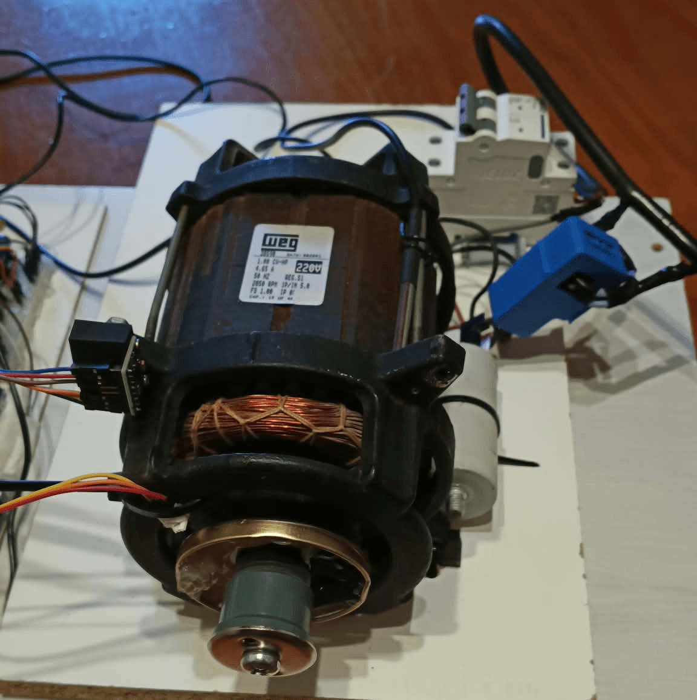
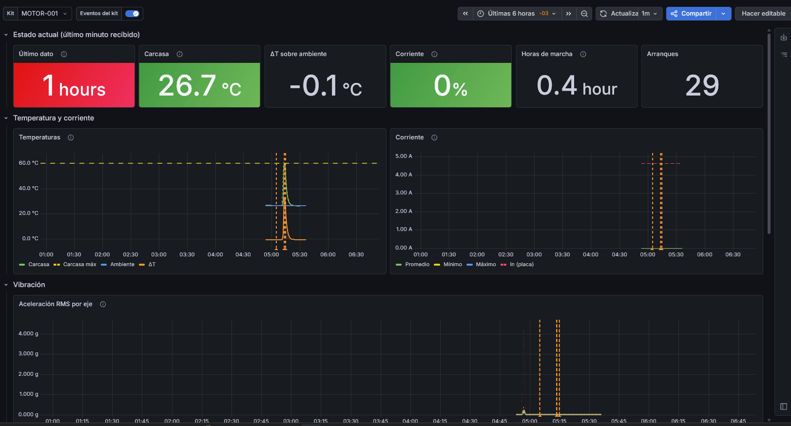

# Centinela Motriz

**Kit abierto y de bajo costo para el monitoreo de condición de motores eléctricos.**



Centinela Motriz mide la vibración, la temperatura, la corriente y la velocidad de un motor eléctrico. Con esos datos lleva las horas reales de marcha, guarda el registro de mantenimientos y avisa con un semáforo cuando algo se sale de lo normal. Está hecho con un Arduino UNO, un ESP32 y módulos que se consiguen en cualquier casa de electrónica.

Es mi proyecto final del curso de Automatización y Robótica de la Fundación YPF (2026).

## El problema

En muchos talleres y pymes los motores se reparan cuando se rompen o se revisan por calendario, hayan trabajado mucho o poco. Sin embargo, muchas fallas se anuncian antes: el motor empieza a vibrar más, a calentar más o a consumir más corriente que de costumbre.

Los equipos de monitoreo industriales detectan esos cambios, pero son caros y están pensados para plantas grandes. La idea de Centinela Motriz es acercar el mantenimiento predictivo a quien tiene pocos motores y poco presupuesto.

## Qué hace

- Mide la **vibración general** del motor en 3 ejes.
- Mide la **temperatura** de la carcasa y del ambiente, la **corriente** y las **RPM**.
- Avisa con un **semáforo y un buzzer** cuando la corriente o la temperatura superan los umbrales. Las alarmas se deciden en el kit y funcionan sin internet. **El kit nunca apaga el motor: solo avisa.**
- Lleva un **horómetro** de horas reales de marcha y cuenta los arranques.
- Guarda el **registro de mantenimientos**, que se carga desde una app Android por Bluetooth.
- Guarda **todos los datos en una tarjeta SD**, segundo a segundo.
- Opcionalmente, manda un resumen por minuto a un **servidor** donde se grafican los datos, se comparan contra la línea base del motor sano y se calculan tendencias. Un bot de Telegram manda un parte diario y responde consultas.

```text
Sensores ─► Arduino UNO ──► ESP32 ──► Tarjeta SD
                              ├──► Bluetooth ──► App Android
                              └──► WiFi ──► n8n ──► PostgreSQL ◄── Grafana
```



## A quién le sirve

- Pymes y talleres con pocos motores críticos: bombas, compresores, ventiladores, cintas.
- Escuelas técnicas y cursos de automatización, electromecánica o mantenimiento, como práctica integradora.
- Estudiantes y técnicos que quieran ver cómo funciona el monitoreo de un motor con un equipo que pueden armar y abrir.

## Alcance

Este proyecto **no busca dar mediciones exactas ni calibradas**. La vibración se mide como un valor general y se evalúa comparando cada motor contra sus propios valores de cuando estaba sano: lo que importa es si cambia, no el número absoluto.

Las mediciones no están validadas contra instrumentos calibrados. Profundizar en ellas, con calibración y análisis más detallado de la vibración, queda como trabajo futuro. Las mejoras posibles están al final del [manual](docs/MANUAL.md#6-mejoras-futuras).

## Seguridad

El kit trabaja cerca de instalaciones de 220 V. La pinza SCT-013 no es invasiva, pero
colocarla implica acceder a los cables del motor: hacelo con la instalación sin tensión
y solo si sabés lo que hacés. El kit solo avisa; no reemplaza las protecciones del motor
(térmico, guardamotor, diferencial). Es un prototipo de banco de pruebas, sin calibrar
ni certificar.

## Herramientas utilizadas

| Herramienta | Uso |
|---|---|
| Arduino IDE | Firmware del UNO y del ESP32 |
| MIT App Inventor | App Android de mantenimiento |
| Docker | Levantar el servidor con un solo comando |
| PostgreSQL | Base de datos |
| n8n | Recepción de datos y bot de Telegram |
| Grafana | Tableros y gráficos |
| OpenAI (opcional) | Redacción del parte diario del bot |

## Estructura del repositorio

```text
centinela-motriz/
├── README.md
├── docs/
│   ├── MANUAL.md       componentes, conexiones, firmware, servidor y app
│   ├── GLOSARIO.md     términos de vibración, mantenimiento e indicadores
│   ├── FUENTES.md      referencias
│   ├── BOT-TELEGRAM.md configuración del bot de Telegram (opcional)
│   └── img/
├── firmware/           código del Arduino UNO y del ESP32
├── servidor/           Docker Compose con PostgreSQL, n8n, Grafana y los workflows del bot
└── app/                proyecto de App Inventor
```

## Empezar

1. Leer el [manual](docs/MANUAL.md). Los términos técnicos están en el [glosario](docs/GLOSARIO.md).
2. Armar el hardware siguiendo las tablas de conexiones.
3. Cargar el firmware en las dos placas.
4. Opcional: levantar el servidor en tu PC con Docker.

## Estado

Versión **0.6**. Funciona en el banco de pruebas: un motor WEG monofásico de 1 CV y 2850 rpm, con todo armado en protoboard.

El proyecto sigue en desarrollo: lo voy a seguir actualizando y mejorando a medida que avance con las [mejoras futuras](docs/MANUAL.md#6-mejoras-futuras). Si lo armás, encontrás un error o tenés una idea, podés abrir un *issue*.

## Cómo lo hice

El diseño, el armado, las mediciones y las pruebas en el banco son de mi autoría. Los realicé como
técnico electromecánico, con un motor WEG real, un tester y una pinza comercial para comparar.

Además, trabajo como desarrollador, así que la parte de servidor (Docker, PostgreSQL, n8n,
Grafana) la armé con lo que ya sabía. Arduino y la electrónica no eran del todo nuevos para mí,
pero igual aprendí mucho sobre la marcha, con hojas de datos, apuntes del curso y material de la web.

Me apoyé en herramientas de IA para revisar y ordenar el código, resolver dudas de
C++ en Arduino y redactar esta documentación. Entiendo todo lo que está en el
repositorio, lo probé en el kit y puedo explicarlo.

## Licencia

El código está bajo licencia MIT y la documentación bajo CC BY-SA 4.0. Ver [LICENSE](LICENSE).

## Autor

Ariel Muñoz, técnico electromecánico y desarrollador web.

[LinkedIn](https://www.linkedin.com/in/ariel-alejandro-mu%C3%B1oz/)