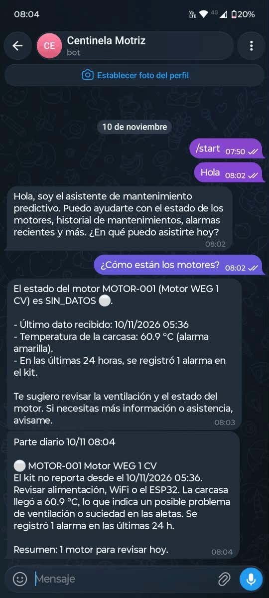

# Bot de Telegram

El bot es opcional y corre en n8n. Son dos workflows que usan un modelo de OpenAI:

| Workflow | Cuándo corre | Qué hace |
|---|---|---|
| `servidor/n8n/wf-parte-diario.json` | Todos los días a las 8:00 | Lee `v_estado_motor`, la IA redacta el parte y lo manda por Telegram |
| `servidor/n8n/wf-consultas-telegram.json` | Cuando le escribís al bot | Un agente responde preguntas con 4 consultas de solo lectura a la base y recuerda los últimos 10 mensajes |

La vista SQL (`servidor/postgres/03-vista-estado-motor.sql`) calcula todo: el semáforo, los motivos, la línea base, la tendencia y el próximo mantenimiento. La IA no calcula nada, solo explica esos resultados en texto. Así, si se equivoca, se equivoca en la redacción, no en los números.

Los prompts están dentro de los JSON: en el nodo "Redactar parte" del parte diario y en el "Agente de mantenimiento" de consultas.



```text
Parte diario:  8:00 → Leer estado de motores → Juntar motores → Redactar parte (+ OpenAI) → Enviar por Telegram
Consultas:     Telegram Trigger → ¿Es mi chat? → Agente (+ OpenAI, memoria y 4 herramientas) → Enviar por Telegram
```

## 1. Crear el bot y obtener el chat_id

1. En Telegram, abrir **@BotFather**, mandar `/newbot` y elegir un nombre y un usuario terminado en `bot`. Guardar el **token**: es un secreto.
2. Mandarle cualquier mensaje al bot.
3. Abrir en el navegador `https://api.telegram.org/bot<TOKEN>/getUpdates` y buscar `"chat":{"id":123456789`. Ese número es el **chat_id**.

Hay que hacerlo **antes** de publicar el workflow de consultas: cuando n8n registra el webhook, `getUpdates` deja de devolver mensajes.

## 2. Credenciales en n8n

En *Overview → Credentials → Create*:

| Credencial | Datos |
|---|---|
| **Postgres** (por ejemplo, `Monitor lectura`) | Host `postgres`, base `monitor`, usuario `grafana_lector`, contraseña `GRAFANA_DB_PASSWORD` del `.env`, puerto 5432, SSL deshabilitado (es la red interna de Docker) |
| **OpenAI** | La API key |
| **Telegram** | El token de @BotFather |

El bot usa el **usuario de solo lectura**: aunque el agente se confunda, no puede modificar nada. No usar la credencial de `monitor_app`, que es la de la ingesta.

## 3. Importar los workflows

1. *Workflows → Import from File*, primero `wf-parte-diario.json` y después `wf-consultas-telegram.json`.
2. En cada workflow, abrir los nodos con advertencia y elegir la credencial:
   - Postgres: "Leer estado de motores" (parte diario) y las 4 herramientas de consultas (`estado_motores`, `tendencia_diaria`, `eventos_recientes`, `mantenimientos`).
   - OpenAI: "OpenAI Chat Model", en los dos.
   - Telegram: "Enviar por Telegram", en los dos, y "Telegram Trigger", en consultas.
3. Reemplazar `TU_CHAT_ID` por tu chat_id:
   - Parte diario: nodo "Enviar por Telegram", campo *Chat ID*.
   - Consultas: nodo "¿Es mi chat?", valor de la derecha de la primera condición. Con este filtro, el bot solo le responde a ese chat.
4. El modelo es `gpt-4o-mini`. Si no aparece, elegir cualquier modelo chico y barato: para esto no hace falta uno grande.
5. Guardar.

## 4. Publicar el webhook de Telegram

Telegram le manda los mensajes a n8n por un webhook, así que n8n tiene que ser accesible por HTTPS. El `docker-compose.yml` ya define `WEBHOOK_URL` con el dominio del `.env`.

La ruta del webhook aparece en el nodo *Telegram Trigger*, en *Production URL*. Tiene la forma `/webhook/<id>/webhook`.

Si n8n está detrás de nginx, se puede abrir solo esa ruta y solo para las redes de Telegram. Esto va en el `server` de n8n, antes de `location /`:

```nginx
location = /webhook/<id>/webhook {
  allow 149.154.160.0/20;   # redes que publica Telegram (pueden cambiar)
  allow 91.108.4.0/22;
  deny all;
  client_max_body_size 256k;
  proxy_pass http://127.0.0.1:5680;
  proxy_set_header Host $host;
  proxy_set_header X-Forwarded-For $remote_addr;
  proxy_set_header X-Forwarded-Proto $scheme;
}
```

```bash
sudo nginx -t && sudo systemctl reload nginx
```

Si el dominio pasa por Cloudflare:
- El `allow`/`deny` funciona solo si nginx recupera la IP real del visitante (módulo `real_ip` con los rangos de Cloudflare). Si no, sacar esas tres líneas.
- Si n8n está protegido con Cloudflare Access, agregar un *Bypass* para la ruta del webhook, igual que para `/webhook/kit`.
- Si está activado *Bot Fight Mode* y no llegan los mensajes, revisar en *Security → Events* si está bloqueando a Telegram.

## 5. Probar

**Parte diario:** abrirlo y tocar *Execute workflow*. Tiene que llegar el parte por Telegram. Si funciona, *Publish*: desde ahí corre solo todos los días a las 8:00.

**Consultas:** publicarlo y escribirle al bot:

- `/start`
- `¿cómo están los motores?`
- `¿cuándo le toca mantenimiento al MOTOR-001?`
- `¿cómo vino la vibración esta semana?`
- `¿hubo alarmas hoy?`

**Para depurar:** el servidor no guarda ejecuciones (`EXECUTIONS_DATA_SAVE_ON_SUCCESS: none`), porque las de la ingesta llevan el token del kit. Estos dos workflows no manejan ese token, así que se puede activar el guardado solo en ellos: menú `...` → *Settings* → *Save successful/failed production executions*.

**Sin datos reales:** cargar `servidor/scripts/ejemplo-envio.json` con curl (ver [manual](MANUAL.md#simularlo-en-tu-pc)); si no, todo aparece como ⚪ SIN_DATOS. El puntaje z necesita al menos 60 minutos en marcha en los 7 días anteriores, y la tendencia, 5 horas de horómetro.

## Problemas comunes

| Síntoma | Causa probable |
|---|---|
| *"An HTTPS URL must be provided"* al publicar | Falta `WEBHOOK_URL` o n8n no se reinició después de cambiarla |
| El bot no responde | Falta el `location` de nginx o el bypass de Access, el chat_id está mal en "¿Es mi chat?" o el workflow no está publicado |
| El Telegram Trigger se queda esperando en modo prueba | La URL de prueba (`/webhook-test/...`) está bloqueada por nginx o Access. Probarlo publicado |
| *"can't parse entities"* | El nodo "Enviar por Telegram" manda el texto como Markdown y un guion bajo (por ejemplo en `SIN_DATOS`) abre un formato que nunca se cierra. Usar *Parse Mode: HTML*, como viene en los workflows |
| Error 401 o 429 de OpenAI | La key no es válida o la cuenta no tiene saldo |
