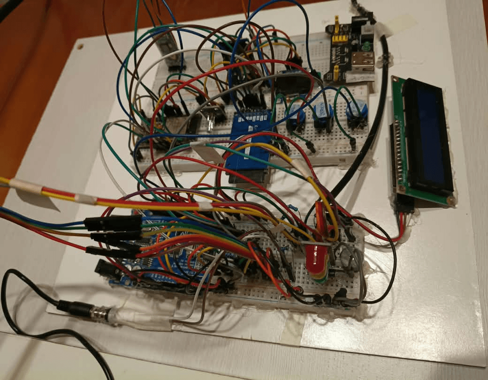
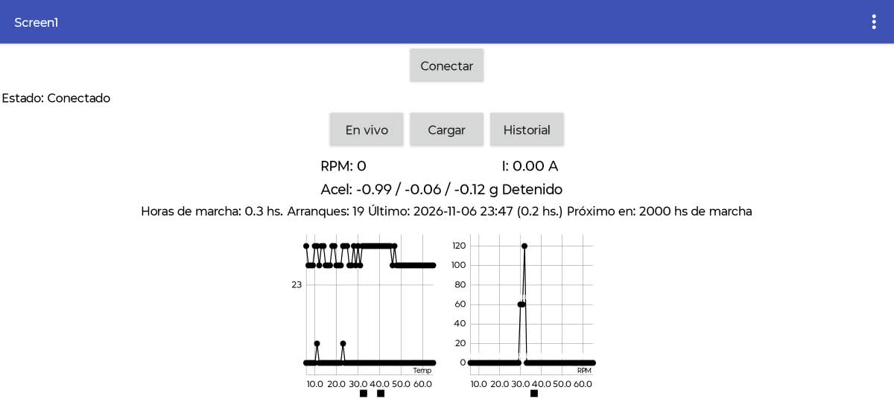

# Manual

Los términos técnicos (RMS, pico, línea base, PREV, OBS…) están explicados en el [glosario](GLOSARIO.md). Las referencias, en [fuentes](FUENTES.md).

1. [Componentes](#1-componentes)
2. [Conexiones](#2-conexiones)
3. [Firmware](#3-firmware)
4. [Servidor](#4-servidor)
5. [App](#5-app)
6. [Mejoras futuras](#6-mejoras-futuras)

---

## 1. Componentes

| Componente | Cant. | Para qué |
|---|---|---|
| Arduino UNO (o compatible) | 1 | Lee los sensores, calcula la vibración, decide las alarmas |
| ESP32 DevKit (38 pines) | 1 | SD, Bluetooth, WiFi, horómetro, mantenimientos |
| Acelerómetro ADXL345 (GY-291) | 1 | Vibración en 3 ejes |
| DS18B20 con sonda de acero | 1 | Temperatura de carcasa (T1) |
| DS18B20 | 1 | Temperatura ambiente (T2) |
| Pinza SCT-013 con carga interna (100 A / 1 V) | 1 | Corriente del motor |
| Sensor Hall A3144 + imán de neodimio | 1 | RPM |
| RTC DS3231 | 1 | Fecha y hora, con pila |
| Módulo microSD + tarjeta | 1 | Respaldo de todos los datos |
| Bluetooth HC-05 | 1 | Comunicación con la app |
| LCD 16x2 con adaptador I2C | 1 | Valores en el UNO |
| OLED SSD1306 0,96" I2C | 1 | Estado en el ESP32 |
| Módulo semáforo (verde, amarillo, rojo) | 1 | Estado del motor |
| LED RGB de ánodo común | 1 | Estado del kit |
| Buzzer pasivo | 1 | Alarma sonora |
| Pulsadores | 3 | Reconocer alarma, cambiar pantalla, probar luces |
| Conversor de nivel 5 V ↔ 3,3 V bidireccional, 4 canales | 1 | ADXL345 y comunicación UNO ↔ ESP32 |
| Resistencias, capacitor de 100 µF, jack de 3,5 mm | — | Pinza y pull-ups |
| Protoboard, cables dupont, fuente de 5 V | — | Montaje |

¿Por qué dos placas? El curso pedía que los sensores estuvieran en un Arduino UNO, pero el UNO no tiene WiFi, Bluetooth ni memoria suficiente. El ESP32 se encarga de todas las comunicaciones.

---

## 2. Conexiones



### Arduino UNO

| Pin | Conectado a | Nota |
|---|---|---|
| D2 | Sensor Hall A3144 | Interrupción. Pull-up de 10 kΩ. Un imán = un pulso por vuelta |
| D4 | Los dos DS18B20 (bus 1-Wire) | Pull-up de 5 kΩ (dos de 10 kΩ en paralelo) |
| D5 / D6 / D7 | Pulsadores: reconocer / pantalla / prueba de luces | A GND, pull-up interno |
| D8 / D9 / D10 | Semáforo verde / amarillo / rojo | |
| D11 | Buzzer | |
| D12 / D13 | RX / TX hacia el ESP32 | A través del conversor de nivel |
| A0 | Pinza SCT-013 | Ver abajo |
| A4 / A5 | I2C: LCD (0x27) y ADXL345 (0x53) | El ADXL345, a través del conversor |

El ADXL345 trabaja a 3,3 V: VCC y CS a 3,3 V, SDO a GND.

### ESP32

| GPIO | Conectado a | Nota |
|---|---|---|
| 16 / 17 | TX / RX del UNO (D13 / D12) | 57600 baudios |
| 26 / 27 | TXD / RXD del HC-05 | 9600 baudios |
| 34 | STATE del HC-05 | 10 kΩ a GND |
| 21 / 22 | I2C: OLED (0x3C) y DS3231 (0x68) | A 3,3 V |
| 5 | CS de la SD | SCK 18, MISO 19, MOSI 23. El módulo SD va a 3,3 V |
| 32 / 33 / 25 | LED RGB rojo / verde / azul | Ánodo común: el pin común va a 3,3 V |

Las dos placas se alimentan con la misma fuente de 5 V y **comparten GND**. Sin GND común, la comunicación entre ellas falla.

### Pinza de corriente

> ⚠️ Colocar la pinza con el motor y la instalación **sin tensión**. Ver [Seguridad](../README.md#seguridad).

El ADC del UNO mide entre 0 y 5 V y la pinza entrega una señal alterna, así que la señal se monta sobre 2,5 V con un divisor:

```text
5 V ──[10 kΩ]──┬──[10 kΩ]── GND
               ├── 100 µF a GND
               └── manga del jack
punta del jack ──[1 kΩ]── A0       (2 × 220 Ω en paralelo entre punta y manga)
```

- El cable de fase pasa **3 veces** por la pinza. Con una sola vuelta la señal era demasiado chica.
- La pinza debe estar a 30 o 40 cm del motor, porque capta su campo magnético.
- El factor de calibración `CAL = 1,04` sale de comparar contra una pinza amperométrica comercial.

### Acelerómetro

- Va sobre la carcasa, lo más cerca posible del rodamiento del lado del eje. Nunca en la tapa del ventilador ni sobre la base.
- Se atornilla a una plaquita metálica, y la plaquita se pega a la carcasa con epoxi en capa fina. Cinta doble faz, silicona o precintos amortiguan la vibración.
- Va en el costado del motor, a la altura del eje, con el eje Z del módulo en dirección radial horizontal (apuntando al eje del motor).
- El cable debe medir menos de 30 cm y estar lejos de los cables de 220 V.

Si se desmonta y se vuelve a montar, hay que volver a medir la línea base.

---

## 3. Firmware

El código está en `firmware/`. Versión actual: **0.6**.

| Carpeta | Placa | Qué hace |
|---|---|---|
| `kit_uno/` | Arduino UNO | Lee los sensores, calcula la vibración, maneja el semáforo y decide las alarmas |
| `kit_esp32/` | ESP32 | Guarda en la SD, lleva el horómetro y los mantenimientos, habla con la app y con el servidor |
| `configurar_hora_ds3231/` | ESP32 | Pone en hora el reloj desde el Monitor Serie |

### Cargarlo

**Librerías** (gestor de librerías del IDE): OneWire, DallasTemperature, LiquidCrystal I2C (Frank de Brabander), Adafruit SSD1306, Adafruit GFX y RTClib.

**UNO:**
1. En `kit_uno.ino`, reemplazar `DIR_CARCASA` y `DIR_AMBIENTE` por las direcciones de tus DS18B20. El ejemplo *Multiple* de DallasTemperature las muestra.
2. Ajustar `IN_PLACA` con la corriente nominal de tu motor.
3. Subir con la placa *Arduino Uno*.

**ESP32:**
1. Copiar `secretos.h.example` como `secretos.h` y completar el WiFi y el token. `secretos.h` no se sube al repositorio.
2. En `servidor.h`, poner la URL de tu webhook.
3. Subir con la placa *ESP32 Dev Module*. Si dice "Sketch too big": *Partition Scheme → Huge APP (3MB No OTA)*.

Sin servidor, el kit funciona igual: guarda todo en la SD y manda los datos a la app.

### Qué mide

| Variable | Sensor | Cómo |
|---|---|---|
| Temperatura de carcasa (T1) y ambiente (T2) | 2 × DS18B20 | Se leen por dirección, así T1 siempre es la carcasa |
| Corriente | Pinza SCT-013 | Valor eficaz (RMS) en 200 ms, que son 10 ciclos de red |
| RPM | Sensor Hall | Pulsos contados durante 1 segundo |
| Vibración | ADXL345 | Valor general (RMS) de cada eje y pico del eje radial, en g |

### Cómo se mide la vibración

Cada segundo, el UNO lee durante medio segundo las muestras del ADXL345: unas 405, porque el sensor entrega unas 811 por segundo. Con esas muestras:

1. **Resta la gravedad.** El sensor siempre mide 1 g hacia abajo por la gravedad, repartido entre los ejes según cómo esté montado. Se resta el promedio de cada eje, que es esa gravedad, y queda solo el movimiento del motor.
2. **Calcula el RMS de cada eje.** Es un solo número que resume cuánto vibró el motor en ese medio segundo.
3. **Guarda el pico del eje radial**, que es la mayor sacudida de la ventana.

El resultado son cuatro valores en g: `rx`, `ry` y `rz` (la vibración general de cada eje, donde `rz` es el radial) y `pico`.

No hay un umbral fijo de vibración: lo que importa es **cuánto cambia respecto de la línea base**, es decir, de lo que medía el mismo motor cuando estaba sano. Esa comparación la hace el servidor.

### Alarmas y semáforo

Las alarmas se deciden en el UNO para que funcionen sin internet. Se vigilan la corriente y la temperatura de carcasa:

| Variable | Amarillo (alerta) | Rojo (alarma) |
|---|---|---|
| Corriente | 100% de la nominal | 115% de la nominal |
| Temperatura de carcasa | 60 °C | 75 °C |

Son valores provisorios. Funcionan así:

- La condición tiene que durar **10 segundos** para cambiar de color. El pico de arranque no dispara nada.
- Para bajar de nivel, el valor tiene que quedar por debajo del **95% del umbral** (histéresis).
- Una alarma roja **queda activa hasta que alguien la reconoce** con el pulsador D5, aunque el valor ya haya vuelto a lo normal. El firmware también acepta el comando `RECON` por Bluetooth, pero la app todavía no tiene el botón.
- Con `MODO_DEMO = true` los umbrales bajan, para mostrar la secuencia apretando la sonda con la mano.

Los significados de cada color están en el [glosario](GLOSARIO.md#indicadores).

### Pantallas

El LCD del UNO tiene dos pantallas, que se alternan con el pulsador D6:

```text
Pantalla 1 (general)        Pantalla 2 (vibración, en g)
T1:38.4 I:2.41              rx0.016 ry0.018
RPM:2850 NORMAL             rz0.044 p0.162
```

Si hay una alerta o una alarma, la segunda línea de la pantalla 1 muestra el estado y la causa, por ejemplo `ALARMA TEMP`.

### Qué hace el ESP32

- **Hora:** todo se guarda en UTC. Con WiFi la hora llega por internet (NTP); sin WiFi, la mantiene el DS3231.
- **Tarjeta SD:** guarda `datos_AAAAMMDD.csv` y `vib_AAAAMMDD.csv` (una línea por segundo), `eventos.csv` y `mantenimientos.csv`.
- **Horómetro:** suma tiempo solo cuando el motor gira (RPM > 300 o corriente > 0,5 A) y lo guarda en la memoria flash.
- **Servidor:** cada minuto manda un resumen con promedios, mínimos y máximos. Si no hay conexión, retiene hasta 15 minutos y reintenta. Igual, todo queda en la SD.

### Tramas entre el UNO y el ESP32

Cada trama es una línea con el formato `$contenido*CS`, donde CS es un control de errores (XOR de los caracteres). Si no coincide, la trama se descarta.

| Trama | Cada | Contenido |
|---|---|---|
| `$D,t1,t2,ax,ay,az,rpm,irms` | 1 s | Temperaturas, gravedad media por eje, RPM, corriente |
| `$V,rx,ry,rz,pico,est` | 1 s | Vibración en g y estado del semáforo |
| `$A,est,causa,detalle` | Cambio de color | Por ejemplo `A,1,TEMP,amarillo T1=61.2` |
| `$S,lcd,adxl,nTemp` | Arranque | Sensores encontrados |
| `$E,RECON` | Al reconocer | Del UNO al ESP32: alarma reconocida con el pulsador |
| `$C,RECON` | Al reconocer | Del ESP32 al UNO: alarma reconocida por Bluetooth |
| `$ACK` | — | Del ESP32 al UNO: confirma `$S` y `$E` |

### Prueba rápida

| Qué | Dónde | Esperado |
|---|---|---|
| Sensores | Monitor Serie del UNO al arrancar | `ADXL345 ID: 0xE5 -> OK`, `Carcasa (T1): OK`, `Ambiente (T2): OK` |
| Vibración | Monitor Serie del UNO | `n:` cerca de 405 y `err:0`; dándole golpecitos al motor suben `rz` y `p` |
| RPM | Monitor Serie del UNO, motor girando | Cerca de la velocidad de placa |
| Envío | Monitor Serie del ESP32, al minuto | `Envio: HTTP 200` |

---

## 4. Servidor

El servidor es opcional. Agrega el histórico, los gráficos, las tendencias y los avisos por Telegram. Los archivos están en `servidor/`.

| Plataforma | Qué hace en el proyecto |
|---|---|
| **Docker** | Empaqueta todo: con un comando se levantan los tres servicios, en un VPS o en tu PC |
| **PostgreSQL** | Guarda los datos. La función `ingesta()` valida el token, rechaza fechas inválidas e ignora los envíos repetidos |
| **n8n** | Recibe los datos del kit por un webhook y los pasa a la base. También maneja el bot de Telegram |
| **Grafana** | Grafica temperatura, corriente, vibración, RPM, horas de marcha y salud del kit. El tablero se carga solo al arrancar |

La regla para la IA: **el servidor calcula, la IA solo redacta.** La vista `v_estado_motor` calcula en SQL la línea base, los cambios, la tendencia y el próximo mantenimiento. El modelo de lenguaje recibe esos resultados y los convierte en un parte diario por Telegram. Cómo configurar el bot: [BOT-TELEGRAM.md](BOT-TELEGRAM.md).

### Simularlo en tu PC

Necesitás Docker (en Windows, Docker Desktop con WSL, y trabajar fuera de `/mnt/c`).

```bash
cd servidor
cp .env.example .env
# en el .env: DATA_DIR=./data-local, las contraseñas,
# y descomentar COMPOSE_FILE=docker-compose.yml:docker-compose.local.yml
mkdir -p data-local/postgres data-local/n8n data-local/grafana
sudo chown 1000:1000 data-local/n8n
sudo chown 472:472 data-local/grafana
docker compose up -d
```

La primera vez se crean solas las tablas, la vista de estado y el tablero de Grafana. n8n queda en `http://localhost:5680` y Grafana en `http://localhost:3300`.

**Dar de alta el kit.** El token es la contraseña del kit: va en `secretos.h` y en la base se guarda solo su hash.

```bash
openssl rand -hex 24
docker compose exec postgres psql -U monitor_app -d monitor -c \
  "SELECT alta_kit('MOTOR-001', 'EL_TOKEN', 'Mi motor', 0.75, 4.65, 2850);"
```

**Workflow de n8n.** Importar `servidor/n8n/ingesta-kit.json` (*Workflows → Import from File*), elegir la credencial de PostgreSQL (usuario `monitor_app`) y publicarlo. Son tres nodos: el webhook recibe, PostgreSQL ejecuta `SELECT ingesta(...)` y el último nodo le responde al kit.

**Probar sin el kit.** Cambiar los `ts` de `scripts/ejemplo-envio.json` por la hora actual (`date +%s`) y enviarlo:

```bash
curl -X POST http://localhost:5680/webhook/kit \
  -H 'Content-Type: application/json' -H 'X-Kit-Token: EL_TOKEN' \
  --data @scripts/ejemplo-envio.json
```

La respuesta esperada es `{"ok": true, "minutos": 1, ...}`. Si se manda dos veces, la segunda devuelve `"minutos": 0`, porque los duplicados se ignoran.

**El tablero de Grafana** está en `grafana/provisioning/dashboards/json/kit-motor.json` y se carga solo al arrancar. Para cambiarlo: abrirlo en Grafana, *Save as* para hacer una copia editable, modificarla, exportarla con *Share → Export → Save to file* y reemplazar el JSON del repositorio.

### Contrato de datos

El ESP32 manda un `POST` con el header `X-Kit-Token` y un JSON como el de `scripts/ejemplo-envio.json`:

| Campo | Qué es |
|---|---|
| `v` | Versión del contrato (hoy, 1) |
| `kit` | Id del kit, por ejemplo `MOTOR-001` |
| `minutos` | Resúmenes por minuto pendientes (hasta 15), con los campos de la tabla de abajo |
| `eventos` | Alarmas, reconocimientos y arranques: `ts`, `tipo`, `origen`, `detalle` |
| `mantenimientos` | Mantenimientos nuevos cargados desde la app |
| `salud` | Estado del kit: `ts`, `rssi`, `heap`, `uptime`, `err`, `sd` |

Cada elemento de `minutos`:

| Campo | Unidad | Qué es |
|---|---|---|
| `ts` | epoch UTC | Inicio del minuto |
| `n`, `marcha` | —, s | Tramas recibidas y segundos en marcha en el minuto |
| `t1`, `t1max`, `t2` | °C | Carcasa (promedio y máximo), ambiente |
| `i`, `imin`, `imax` | A | Corriente |
| `rpm` | rpm | Velocidad del sensor Hall |
| `rx`, `ry`, `rz`, `rzmax` | g | Vibración general por eje (`rz` = radial) y máximo del radial |
| `pico` | g | Mayor sacudida del eje radial |
| `horas`, `arr` | h, — | Horómetro y arranques |

| Respuesta | Cuándo |
|---|---|
| 200 | Guardado (los duplicados se ignoran) |
| 401 `NO_AUTORIZADO` | Token incorrecto |
| 400 `FECHA` | Fecha anterior a 2024 o en el futuro: el kit no tiene hora |
| 400 `VERSION` | El campo `v` no es 1 |
| 400 `DATOS` | Formato inválido |

---

## 5. App



App Android hecha con MIT App Inventor. Se conecta al kit por Bluetooth, así que funciona al lado del motor aunque no haya internet. El proyecto está en `app/`: se importa en App Inventor desde *Projects → Import project (.aia)*. Antes de usarla, hay que emparejar el HC-05 desde los ajustes de Bluetooth del celular. En el kit se llama `MOTOR-001`, igual que el id del kit; de fábrica aparece como `HC-05` y el nombre se cambia con comandos AT.

Tiene una sola pantalla con tres pestañas, porque en App Inventor cambiar de pantalla corta el Bluetooth:

- **En vivo:** temperatura, corriente y RPM, con gráficos de los últimos 60 segundos. Muestra también las horas de marcha y cuándo toca el próximo mantenimiento.
- **Cargar mantenimiento:** tipo, responsable, tareas realizadas, aislación, corriente, repuestos, estado en que quedó el motor e intervalo hasta el próximo. Las horas de marcha las agrega el kit. Los códigos están en el [glosario](GLOSARIO.md#mantenimiento).
- **Historial:** los últimos mantenimientos guardados en el kit, con una copia en el celular.

### Protocolo Bluetooth

Una línea por mensaje, a 9600 baudios. Al conectarse, la app manda `PING`, `TSET` e `INFO`, en ese orden.

| Comando | El kit responde |
|---|---|
| `PING` | `PONG` |
| `TSET,AAAA-MM-DD HH:MM:SS` | `OK,TSET`: pone en hora el kit con la hora del celular |
| `INFO` | `I,horas,arranques,marcha,cantMant,ultFecha,ultHoras,proxHoras` |
| `MADD;fecha;tipo;responsable;tareas;aisl;corriente;repuestos;estado;intervalo;obs` | `OK,MADD,id` |
| `MLIST` o `MLIST,n` | Una línea `M;...` por mantenimiento y al final `MFIN,n` |
| `RECON` | `OK,RECON`: reconoce la alarma |
| `HSET,horas` | `OK,HSET`: carga las horas que ya tenía el motor |

La app usa `PING`, `TSET`, `INFO`, `MADD` y `MLIST`. `RECON` y `HSET` están en el firmware pero todavía no en la app: se pueden mandar desde cualquier terminal Bluetooth serie del celular.

El kit también manda al celular, cada segundo, `D,t1,t2,ax,ay,az,rpm,irms` y `V,rx,ry,rz,pico,est`, y `A,est,causa,detalle` cuando cambia el semáforo.

---

## 6. Mejoras futuras

- **Línea base fija del motor sano** (una tabla `linea_base`, medida durante varias horas) en lugar de la ventana móvil de 7 días, que detecta cambios bruscos pero va "absorbiendo" una degradación lenta. Con la base fija se pueden poner alarmas de vibración en g.
- **Calibración y validación** de la vibración contra un instrumento de referencia, y de la corriente con el motor cargado.
- **Análisis más detallado de la vibración**, para distinguir qué tipo de problema la causa.
- **Vibración y semáforo en la app**, con un botón para reconocer la alarma.
- **Cola de reintentos en la SD**, para no perder datos en cortes largos de WiFi.
- **Medición de tensión**, para calcular potencia y factor de potencia.
- **Aviso inmediato sin IA** por Telegram cuando un motor pasa a ROJO o SIN_DATOS, guardando el último estado avisado para no repetir mensajes.
- **MQTT** para datos en tiempo real, **RFID** para identificar al técnico y **autenticación propia** en la app.
